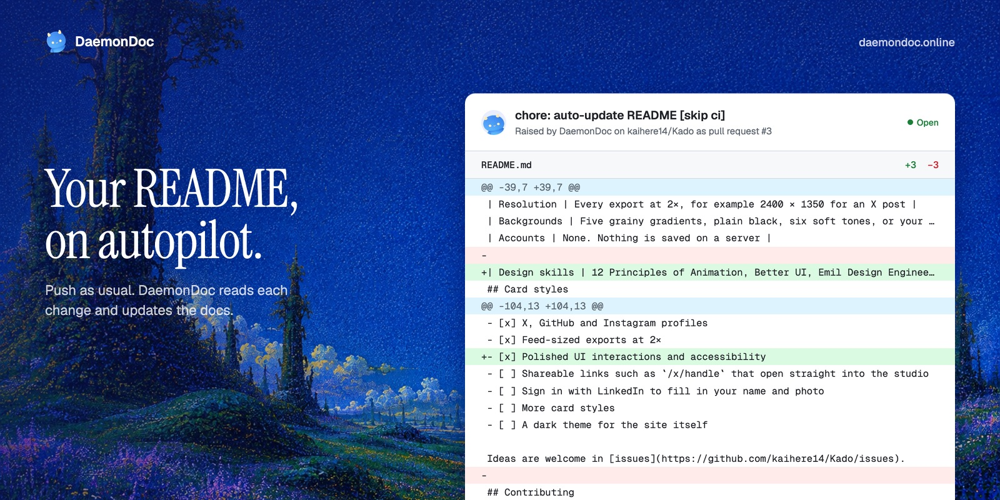

# Skills

Agent skills for shipping and marketing products. Each skill is a folder with a `SKILL.md` that
an agent such as Claude Code loads when a task matches it.

## Skills

| Skill | What it does |
| --- | --- |
| [product-launch-images](product-launch-images) | Screenshots your product and turns it into studio-quality social images in your own brand, in every platform size, plus ready-to-post copy for X, LinkedIn and Instagram. |



## Install

Clone the repo once, then link the skills you want into your agent's skills folder.

```bash
git clone https://github.com/kaihere14/skills.git ~/skills
```

**Claude Code, all projects**

```bash
mkdir -p ~/.claude/skills
ln -s ~/skills/product-launch-images ~/.claude/skills/product-launch-images
```

**Claude Code, one project**: link or copy the folder into `<project>/.claude/skills/`.

**Other agents** that read the Agent Skills format: link or copy the folder into the agent's
skills directory (often `.agents/skills/`).

A symlink lets you get updates with `git pull`. Restart the agent after adding a skill.

## Requirements

Each skill lists its own requirements in its README. Summary:

| Skill | Needs |
| --- | --- |
| product-launch-images | Node.js 18+, Python 3 with Pillow, ffmpeg, internet access, macOS (uses `sips`). Claude in Chrome recommended; otherwise Playwright and Chromium install on first run. |

## Repository layout

```
<skill-name>/
  SKILL.md          instructions the agent loads (required)
  README.md         what it does, requirements, examples (for people)
  scripts/          helper scripts the skill runs
  templates/        files the skill copies and fills in
  examples/         sample output for the README
template/           starting point for a new skill
README.md           this file
LICENSE
```

## Adding a skill

1. Copy `template/` to `<skill-name>/`. Use lowercase kebab-case, and make the folder name
   match the `name:` field in `SKILL.md`.
2. Write the `description:` line carefully. Agents decide whether to use a skill from this line
   alone, so list the phrases a user would actually type.
3. Fill in the skill's `README.md`, including requirements and at least one example.
4. Add a row to the **Skills** and **Requirements** tables above.

## License

[MIT](LICENSE)
