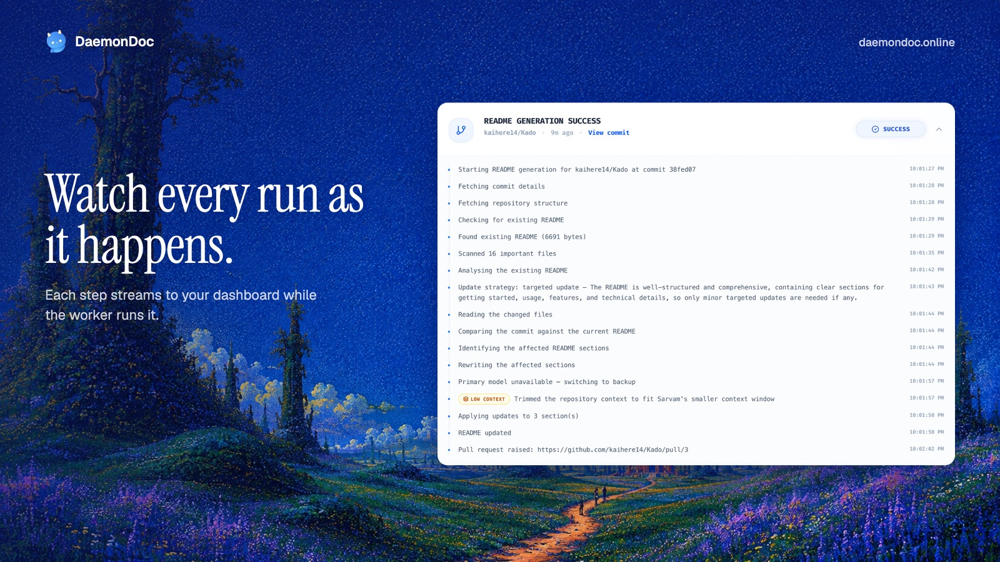
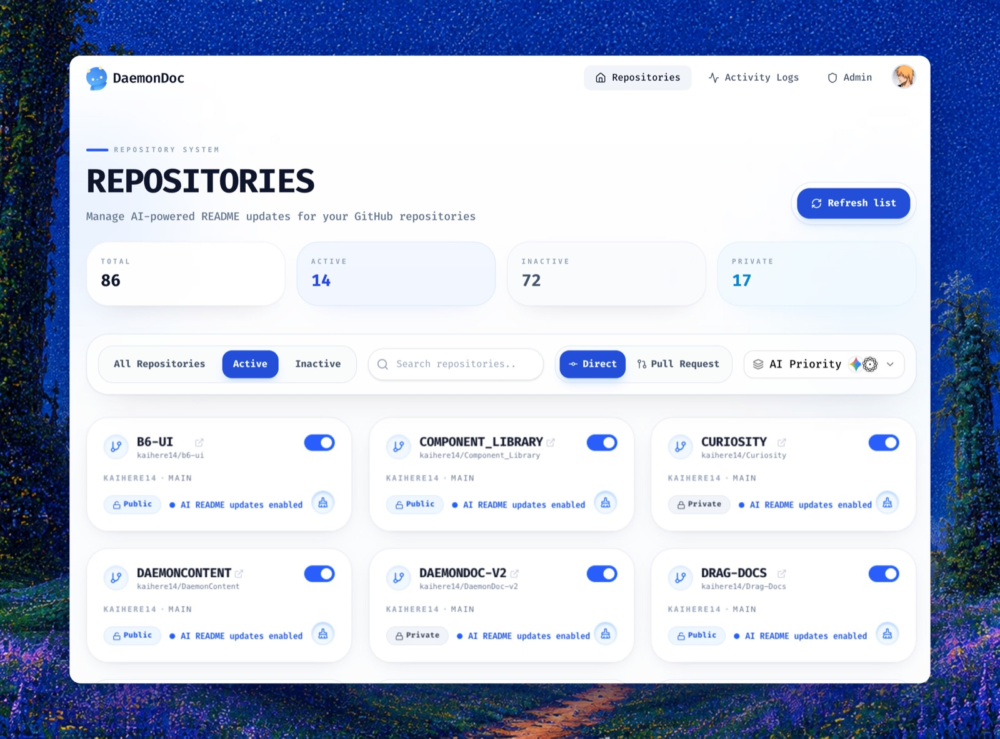
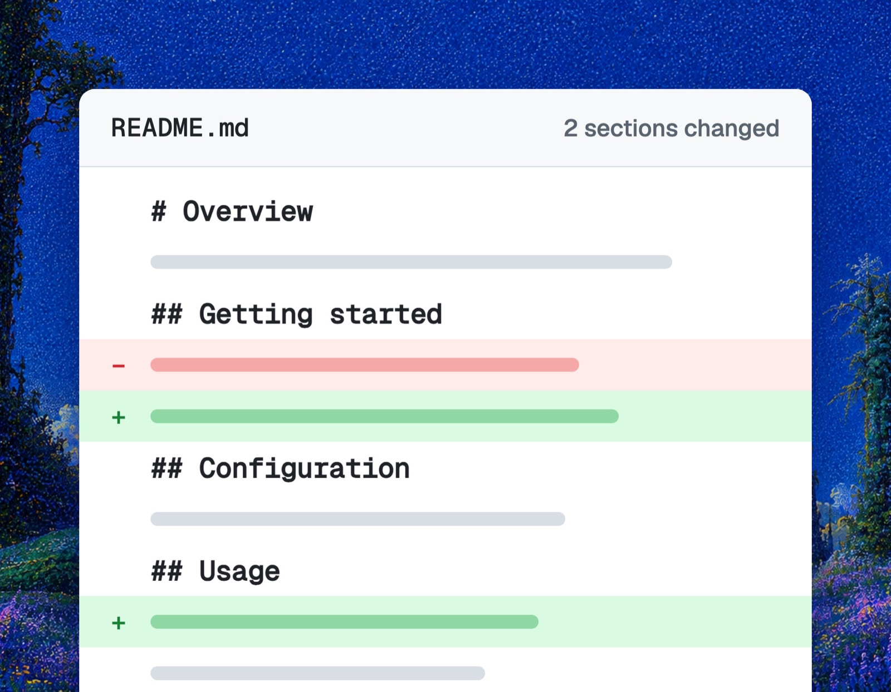
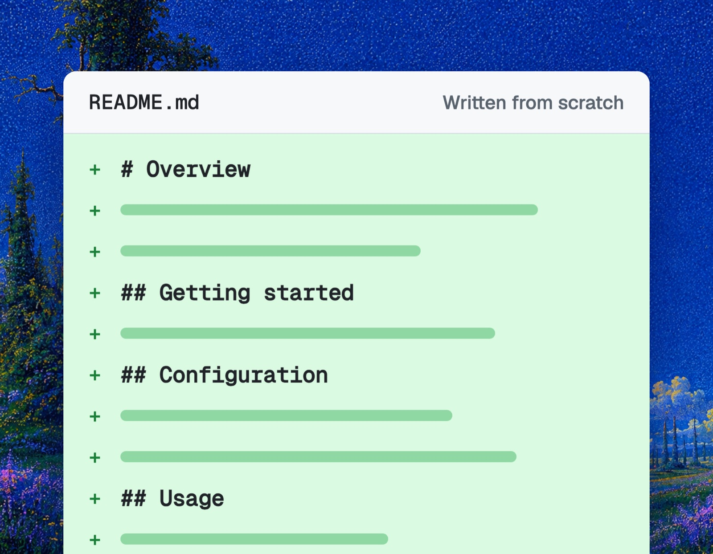
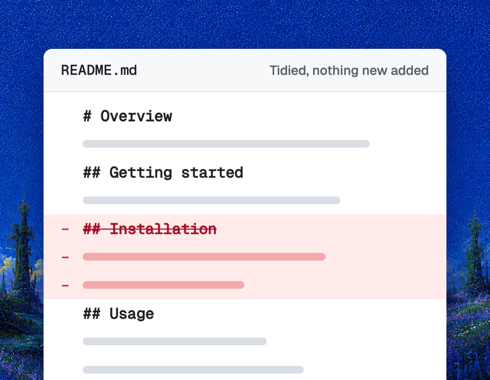

# product-launch-images

Turns your product into social images that look made by a design studio, not generated, and
writes the posts to go with them.

Ask your agent something like *"make launch images for my product"* or *"post about the new
export feature on X and LinkedIn"*. The skill:

1. Reads your repo or site to get the product name, pitch and real features.
2. Finds your brand art (hero illustration, logo, brand colours) to use as the background.
3. Screenshots the live site with Playwright and crops the useful parts.
4. Builds each card in HTML, in every size you need, and renders it at 2x.
5. Checks every card against a quality checklist and fixes what fails.
6. Saves numbered PNGs to `~/Downloads/<Product>-Social-<post>/` and writes the post copy.

## Examples

Made for [DaemonDoc](https://daemondoc.online):

| | |
| --- | --- |
|  |  |
|  |  |
|  |  |

## What you get

- Cards in the sizes each platform needs:

  | Format | Size | For |
  | --- | --- | --- |
  | Landscape | 1600x900 | X, LinkedIn, threads |
  | Portrait | 1080x1350 | LinkedIn and Instagram feed |
  | Square | 1080x1080 | Instagram, LinkedIn carousel |
  | Story | 1080x1920 | Stories, Shorts covers |

- An X thread mapped to the card order, plus a single-post version.
- A LinkedIn post, and an Instagram caption if you ask for one.
- A list of anything to fix before posting, and which panels are mock-ups.

## Requirements

- **Node.js 18 or later.** On first run the skill installs Playwright and Chromium (about 150 MB)
  into a temporary work folder, never into your project.
- **Python 3 with Pillow** (`pip install pillow`) for cropping screenshots.
- **macOS.** The skill uses `sips` to resize images.
- **Internet access** for the live site and Google Fonts (Instrument Serif and Geist).
- **A public URL** for the product. For screens behind a login, give the agent screenshots.

## Install

See the [root README](../README.md#install).

## Files

| File | Purpose |
| --- | --- |
| `SKILL.md` | The instructions the agent follows |
| `scripts/capture.mjs` | Captures the hero view, full page, page text and links |
| `scripts/render.mjs` | Renders each `c*.html` card to PNG at 2x |
| `templates/card.css` | Card design system: canvas, type, panels |
| `templates/example-card.html` | Reference layouts to copy |

## Limitations

- Results are best when your site has distinctive hero art. Without it, the skill falls back to
  your brand colours.
- It uses only real features and facts. It will not invent metrics, customers or testimonials.
